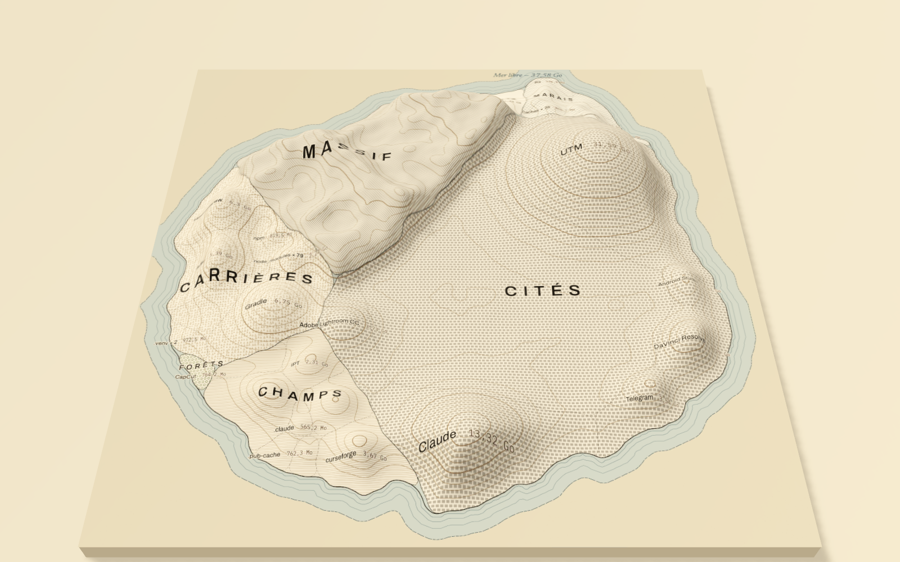
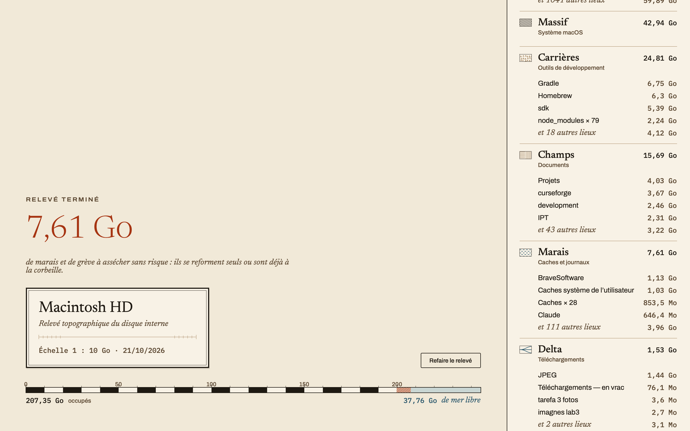

# 🗺️ GoSaver

**A storage atlas for macOS: clean up, understand and migrate your disk.**

GoSaver draws your disk as a printed map. Big folders are mountains, caches are marshes you can drain, free space is the sea, and your external SSD is an overseas continent you can send convoys to.


<!-- DEMO -->

<p align="center">
  
  
</p>

## The metaphor

| Reality | On the map |
|---|---|
| Internal disk | **The island** in its frame |
| Free space | **The sea**: the more you clean, the more it grows |
| Folder size | **Altitude**: big folders are mountains |
| macOS / system | **Massif**: untouchable rock |
| Apps | **Cities**: inhabited, never razed |
| Caches | **Marshes**: they refill on their own, so you can drain them |
| Downloads | **Delta / harbour**: where everything piles up |
| Dev folders (`node_modules`, DerivedData, Gradle…) | **Quarries**: dug by tools, can be regenerated |
| Unknown files | **Ruins**: to be appraised |
| External SSD | **Overseas**: where convoys go |
| Quarantine | **The Lazaretto**: an island where suspicious cargo waits 30 days |

Everything drawn on the map is real data. Nothing is decorative.

## Features

- **Survey:** a parallel, read-only scan of the entire disk in about 10 seconds
- **3D relief map:** proportional geography in RealityKit, fog over unscanned areas, an orbit camera, mouse picking
- **Drain:** caches, logs and trash, with an allow list, re-checked paths, and open apps left alone
- **Convoys to the SSD:** copy → verify (checksums) → replace, with a symlink when an app expects the folder in place, and one-click repatriation
- **Movability judge:** a verdict for each folder (*Free / With link / Not advised / Forbidden*) with the reason, based on the target disk format, symlinks, code signatures, git, iCloud, sparse files and open files
- **Ruins:** finds data left by deleted apps, exact duplicates, used installers, interrupted downloads
- **Lazaretto:** a restorable quarantine on the external disk, purged automatically after 30 days
- **Uninstaller:** removes an app and the leftovers that carry its exact identifier
- **On-device AI advice** (Apple Foundation Models), limited to the actions the engine allows

> **Design principle: the engine decides, the AI explains.** Whether a folder can be moved without breaking anything is a question of verifiable rules (disk format, code signing, open files), not guesswork. The rule engine gives a verdict, and the on-device model only puts it into words. It can never suggest something the engine forbids.

## Build

```bash
scripts/bundle.sh release   # builds build/GoSaver.app
scripts/test.sh             # runs the core test suite
```

Requires macOS 26 and Swift 6. GoSaver asks for **Full Disk Access** on first launch.

## Project layout

```
Sources/GoSaverCore/   scan engine, cartography, movability rules, drainage (no UI, tested)
Sources/GoSaver/       SwiftUI app, RealityKit map, design system
Tests/                 core tests
docs/                  design system ("Atlas" style guide), roadmap
```

## How it was built

I built GoSaver with **Claude Code**. I started with a strict design system ([`docs/DESIGN_SYSTEM.md`](docs/DESIGN_SYSTEM.md)) that defines the map metaphor and a blacklist of generic UI patterns. Then I worked through the [roadmap](docs/FEUILLE_DE_ROUTE.md) one feature at a time. The full log of prompts and decisions is in [`historique_prompts.md`](historique_prompts.md) (in French).

## License

[MIT](LICENSE). Bundled fonts are under the [SIL Open Font License](Sources/GoSaver/Resources/Fonts/OFL.txt).
